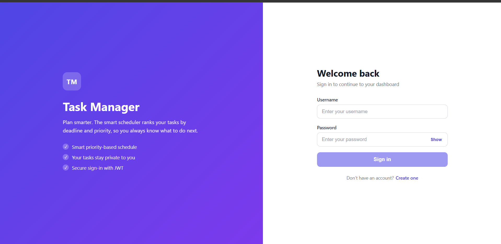
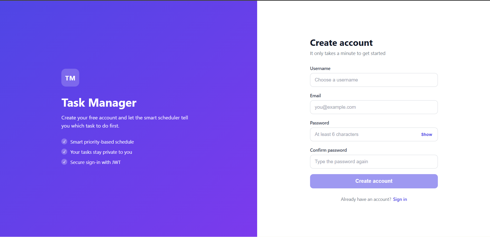

# Task Management System

A full-stack task manager with JWT authentication and a "Smart Schedule" that ranks
tasks by deadline and priority using a min-heap.

**Stack:** Spring Boot, Spring Security, JPA/Hibernate, MySQL, JWT · Angular 21 (signals, standalone components)

## Screenshots




## Features
- Register / login with BCrypt-hashed passwords and JWT (24h expiry)
- Create, edit, complete and delete tasks; each user sees only their own tasks
- Smart Schedule: tasks ranked by urgency (overdue first, no deadline last)
- Consistent JSON error format with proper status codes (400/401/404/409)

## How the Smart Schedule works
score = hours until deadline - priority bonus (LOW 0, MEDIUM 24, HIGH 72, URGENT 120).
Lowest score is done first. A `PriorityQueue` (min-heap) gives O(n log n) ordering.
Completed tasks are excluded.

## Architecture
Angular (Component -> Service -> HttpClient -> interceptor adds JWT)
-> Spring (JWT filter -> Controller -> Service -> Repository) -> MySQL

## API
| Method | Path | Auth | Description |
|---|---|---|---|
| POST | /api/auth/register | public | Create account, returns token |
| POST | /api/auth/login | public | Returns token |
| GET | /api/tasks | JWT | My tasks |
| GET | /api/tasks/{id} | JWT | One task (404 if not mine) |
| POST | /api/tasks | JWT | Create task |
| PUT | /api/tasks/{id} | JWT | Update task |
| DELETE | /api/tasks/{id} | JWT | Delete task |
| GET | /api/tasks/schedule | JWT | Tasks ranked by the scheduler |

## Run locally
**Requirements:** Java 17, Maven, MySQL, Node 22, Angular CLI

1. Create a MySQL database: `CREATE DATABASE taskmanager;`
2. Backend (port 8080):
```
   cd backendnew
   set DB_USERNAME=root
   set DB_PASSWORD=<your password>
   set JWT_SECRET=<a long random string, 32+ chars>
   ./mvnw spring-boot:run
```
3. Frontend (port 4200):
```
   cd task-manager-ui
   npm install
   ng serve
```
4. Open http://localhost:4200

## Design decisions
- Owner is taken from the JWT, never from the request body
- Another user's task returns 404, not 403, so its existence isn't revealed
- Domain exceptions + `@RestControllerAdvice` for one error format
- Known limitation: token is in localStorage; an HttpOnly cookie would be safer


## Run with Docker
```
docker compose up --build
```
Then open http://localhost:4200

## Future work
Pagination, refresh tokens